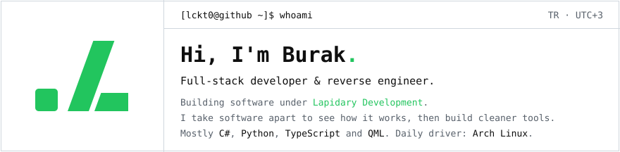
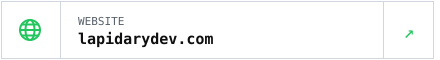
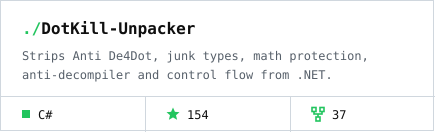
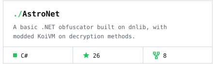
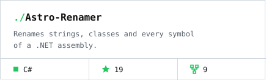
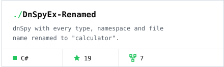

<a href="https://github.com/lckt0"><picture><source media="(prefers-color-scheme: dark)" srcset="assets/section-whoami-dark.svg"></picture></a> 
<a href="https://lapidarydev.com"><picture><source media="(prefers-color-scheme: dark)" srcset="assets/header-dark.svg"></picture></a> 
<a href="https://lapidarydev.com"><picture><source media="(prefers-color-scheme: dark)" srcset="assets/link-web-dark.svg"></picture></a><a href="mailto:burak@lapidarydev.com"><picture><source media="(prefers-color-scheme: dark)" srcset="assets/link-mail-dark.svg"></picture></a>

 

<a href="https://github.com/lckt0?tab=repositories"><picture><source media="(prefers-color-scheme: dark)" srcset="assets/section-starred-dark.svg"></picture></a> 
<a href="https://github.com/lckt0/DotKill-Unpacker"><picture><source media="(prefers-color-scheme: dark)" srcset="assets/repo-dotkill-unpacker-dark.svg"></picture></a><a href="https://github.com/lckt0/AstroNet"><picture><source media="(prefers-color-scheme: dark)" srcset="assets/repo-astronet-dark.svg"></picture></a> 
<a href="https://github.com/lckt0/Astro-Renamer"><picture><source media="(prefers-color-scheme: dark)" srcset="assets/repo-astro-renamer-dark.svg"></picture></a><a href="https://github.com/lckt0/DnSpyEx-Renamed"><picture><source media="(prefers-color-scheme: dark)" srcset="assets/repo-dnspyex-renamed-dark.svg"></picture></a>

